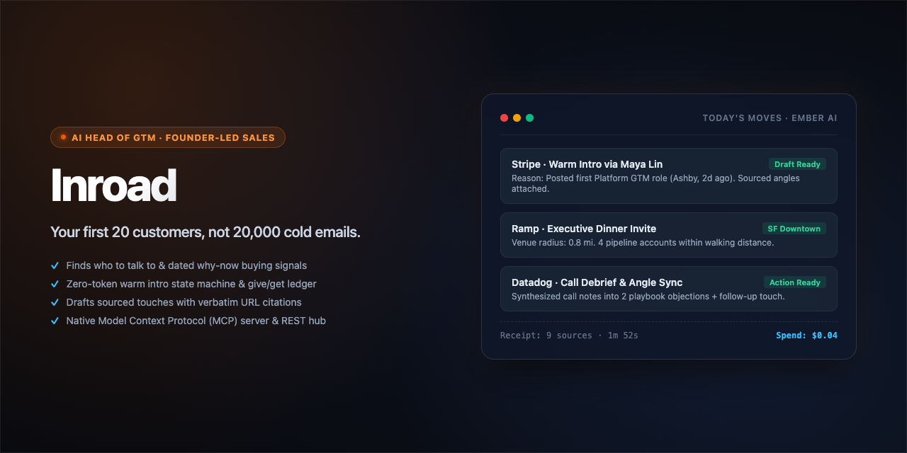

<div align="center">

# Inroad

**An AI Head of GTM for founder-led sales — finds who to talk to and why now, drafts every touch with verifiable sources, preps every call, and coordinates outbound pipeline.**

[Architecture](#architecture) · [Core Capabilities](#core-capabilities) · [Engineering Deep Dives](#engineering-deep-dives) · [Quick Start](#quick-start) · [Token Economics](#how-it-keeps-token-spend-low)

<br/>

[](https://github.com/aiden-guan/inroad/actions/workflows/ci.yml)
[](LICENSE)
[](package.json)
[](package.json)

<br/>



</div>

---

## What It Does

**Your first 20 customers, not 20,000 cold emails.**

Inroad automates the operational groundwork that high-performing heads of GTM execute for early-stage companies:
it discovers high-intent accounts and verifiable buying signals (starting with warm connections already in your network), drafts hyper-targeted touches with primary source citations, prepares deal dossiers for calls, debriefs meetings, maintains pipeline velocity, plans local executive dinners, and runs a focused weekly operating rhythm.

**You do the selling.** Inroad never sends an email, posts a message, or modifies deal stages autonomously. Every outbound artifact is presented as a draft for founder review and one-click approval.

**Studio writes the marketing.** Launch posts, homepage heroes, ads, image text, short-video scripts, Show HN and Product Hunt launches, store listings and comparison pages, for founders of any kind of company (B2B, consumer, prosumer, developer tools). It writes from the founder's own material, gives several options built on different moves from campaigns that worked (Wispr Flow, Ramp, Supabase, Linear), and checks every option in code for AI tells, unsourced numbers and platform limits before a blind reader ranks them. The research behind it is in [`docs/research/10-marketing-copy.md`](docs/research/10-marketing-copy.md).

**Studio also makes the graphics.** For any option, Claude designs the graphic (LinkedIn and X images, 4:5 feed, square, 9:16 story, link previews, Product Hunt gallery) as SVG around the option's checked words. Code strips anything unsafe and checks every word against the approved copy, plus contrast, safe zones and type size, then renders the PNG on your machine. Claude looks at that render and fixes what fails. A design can sit over a real screenshot you upload, or over a photo or illustration painted by OpenAI's GPT Image if you add an OpenAI key in Settings. Without a key, Claude writes the prompt for you to paste into ChatGPT. Painted pictures never contain words, never stand in for your product's UI, and are labeled as AI imagery so you can disclose them where Meta and TikTok ask. The Claude API reads images but doesn't output them, which is why Claude designs in code.

Inroad also operates as an **agentic coordination hub**: connect external systems (HubSpot, Attio, Instantly, Smartlead, Lemlist, Slack, Clay, Zapier, n8n, Firecrawl) and allow peer agents—Claude Code, Cursor, ChatGPT, Meta Muse—to query your playbook, inspect warm network paths, and inject qualified leads through Inroad's native MCP server and REST endpoints.

---

## Core Capabilities

| Today's Moves & Pipeline Rhythm | Warm Intro State Machine |
| :--- | :--- |
| **Actionable 5-Move Queue**<br/>Surfaces at most 5 high-priority actions per day (reply checks, deal reviews, touch approvals, closeouts), each paired with ready-to-send copy. | **Deterministic Relationship Ledger**<br/>Tracks intros end-to-end (ask, forward, intro, meeting, close-the-loop). Enforces connector etiquette: one open ask per connector, 14-day rest intervals, and give-before-get thresholds in code. |

| Deterministic Signal Radar | Multi-Agent Coordination Hub |
| :--- | :--- |
| **Free, Code-First Research Layer**<br/>Monitors job boards (Greenhouse, Lever, Ashby, Workable), tech stack indicators, news, and Hacker News via plain HTTP before any LLM inference occurs. | **Native Model Context Protocol (MCP)**<br/>Exposes workspace state, playbook positioning, and warm paths to external coding agents and tools via standard MCP tools and REST webhooks. |

| Studio: Marketing Copy That Sounds Human | Copy Tools for Outside Agents |
| :--- | :--- |
| **Receipts, Moves, Lint, a Blind Reader**<br/>20 formats with real platform limits (each with its source and how it was verified). Every specific must trace to the founder's material or an approved claim. Deterministic lint for AI tells (Wikipedia's signs, Kobak et al. excess vocabulary, density scoring), "up to" vs "on average" drift and unproven superlatives. | **`get_copy_guide` and `check_copy`**<br/>Claude Code, Cursor or n8n get the same format specs, moves and receipts over MCP and REST, and lint their own drafts at zero token cost to Inroad. |

| Event & Executive Dinner Planning | Sourced Deal Dossiers |
| :--- | :--- |
| **Geographic Prospect Clustering**<br/>Visualizes pipeline deals and customers on a local map. Set a dinner venue and radius to instantly generate scored guest lists and tailored invites. | **Verifiable Provenance**<br/>Every angle, prospect pain point, and qualification hypothesis links to exact source URLs and dates. Speculative inferences are stamped as unconfirmed bets. |

---

## Architecture

Inroad is structured around a local-first reactive model where deterministic signal scrapers, atomic JSON storage, and a multi-tiered LLM orchestration loop interact through typed boundaries.

```mermaid
flowchart LR
    subgraph Client["Client Surface (Next.js 16 / React 19)"]
        UI["Today / Moves / Board UI"]
        CmdK["Command Palette (Ask ⌘K)"]
        SSEListener["SSE Stream Consumer"]
    end

    subgraph Gateway["Application Layer & Integrations"]
        API["Route Handlers (/api/*)"]
        MCPEndpoint["MCP Server & REST Gateway"]
        WebhookHandler["Webhook Dispatcher"]
    end

    subgraph Core["Execution Engine"]
        Engine["Agent Engine (src/lib/ai/engine.ts)"]
        SignalPipeline["Signal Fetchers (src/lib/signals/*)"]
        SSRFGuard["Guarded Undici Dispatcher"]
        IntroSM["Intro & Move State Machine"]
    end

    subgraph Storage["Persistence Layer (.data/)"]
        FileDB["Atomic FileDB (JSON Store)"]
        SecretVault["Local Secret Store"]
    end

    UI -->|REST / Mutations| API
    CmdK -->|Prompt Stream| API
    SSEListener <---|Event Stream (SSE)| Engine

    MCPEndpoint <-->|External Tools & Agents| API
    API --> Engine
    API --> IntroSM

    Engine -->|Web / News / Job Signals| SignalPipeline
    SignalPipeline --> SSRFGuard
    SSRFGuard -->|Sanitized HTTP| ExternalWeb[("Public Web")]

    Engine -->|LLM Inference (Opus / Sonnet / Haiku)| ClaudeAPI[("Anthropic API")]
    IntroSM --> FileDB
    Engine --> FileDB
    API --> SecretVault
```

### End-to-End Execution Flow

1. **Intake & Signal Scanning**: A scheduled task or founder prompt triggers `src/lib/signals/http.ts` to crawl public company endpoints, career portals (Greenhouse, Ashby, Lever), and news feeds using an SSRF-hardened HTTP client.
2. **Deterministic Pre-Processing**: Signal parsers extract structured events (new leadership hires, platform migrations, seed funding) and summarize them into a compact plaintext digest entirely in Node.js runtime code.
3. **Multi-Tier Agent Reasoning**: The compiled digest is handed to `src/lib/ai/engine.ts`. The engine dispatches synthesis to Anthropic Claude (Opus 5.5 for ICP positioning, Sonnet 5.5 for draft generation, Haiku 5.5 for triage). Prompts use structured cache breakpoints to prevent re-billing stable system contexts.
4. **Validation & Quality Gates**: The agent invokes zod-validated tools (`submit_playbook`, `draft_touch`). Terminal tools halt generation and stream structured JSON through `src/lib/quality/gates.ts` to verify length constraints, link presence, and tone guidelines.
5. **Atomic Persistence & UI Event Stream**: Validated moves and deal updates are committed to `.data/` using write-and-rename atomic semantics via `src/lib/store/file-db.ts` and pushed to the client over Server-Sent Events (SSE).

---

## Engineering Deep Dives

### 1. SSRF Guard with Anti-DNS-Rebinding Dispatcher

- **Problem**: Inroad ingests arbitrary website URLs and webhook targets submitted by external agents, webhooks, and founder inputs. Standard Node.js `fetch` is vulnerable to Server-Side Request Forgery (SSRF) and DNS rebinding attacks where a public host name resolves to a private IP (e.g. `127.0.0.1`, cloud metadata `169.254.169.254`, or IPv4-mapped IPv6 `::ffff:127.0.0.1`) after initial validation.
- **Approach**: Implemented a custom `undici` Agent with a `guardedLookup` hook in `src/lib/signals/http.ts`. The resolver checks every resolved IP against an explicit `net.BlockList` of IPv4/IPv6 private, link-local, loopback, and CGNAT subnets at socket connection time, repeating the verification across every HTTP redirect hop.
- **Why**: Pre-validating URLs via a standalone `dns.resolve()` call leaves a time-of-check to time-of-use (TOCTOU) gap that DNS rebinding exploits. Hooking resolution inside socket connection guarantees that the actual connected remote address is validated.
- **Tradeoff**: Increases outbound request latency by ~10–20ms for double DNS lookups and prevents indexing intranet test servers without explicit loopback exemptions in test fixtures.

### 2. Tiered LLM Orchestration with Two-Point Prompt Caching

- **Problem**: Generating thorough account dossiers and multi-touch outbound campaigns consumes large token volumes when full system instructions, ICP definitions, and company dossiers are repeatedly re-sent across conversational turns.
- **Approach**: Built a single streaming loop (`src/lib/ai/engine.ts`) enforcing strict model separation and prompt-cache architecture. Heavy positioning tasks run on Opus 5.5, research synthesis runs on Sonnet 5.5, and rapid screening runs on Haiku 5.5. System prompts are structured into ordered blocks where cache breakpoints (`cache_control`) are placed on the immutable foundation and ICP blocks, while dynamic per-account signals are isolated to user turns.
- **Why**: Flat monolithic prompt chains inflate token costs linearly with conversation depth. Hierarchical block caching allows 70–85% of input tokens to hit Anthropic prompt cache reads at a 90% discount.
- **Tradeoff**: Editing the core ICP definition or system prompt invalidates the cache for downstream requests, incurring a one-time cold write penalty.

### 3. Pure-Code Warm Intro Engine & Connector Etiquette Ledger

- **Problem**: Using generative LLMs to manage relationship state, intro timings, and nudge cadences frequently results in inconsistent status evaluations, duplicated messages, and boundary violations (e.g. badgering mutual contacts).
- **Approach**: Built a deterministic finite-state machine in `src/lib/intros/rules.ts` that manages the intro lifecycle (`asked` → `forwarded` → `introduced` → `meeting` → `done`). The engine maintains an explicit give/get ledger with strict timing constants (`connectorRest: 14 days`, `nudgeAfter: 5 days`, `giveFirstAfter: 3 asks`).
- **Why**: Connector etiquette requires deterministic guarantees that cannot fail due to model drift or hallucinations. Running relationship rules in TypeScript ensures 0 token cost, instant evaluation, and verifiable invariants tested across 14 regression cases.
- **Tradeoff**: Rules require explicit code modifications to change timing thresholds rather than prompt-based natural language adjustments.

---

## How It Keeps Token Spend Low

Inroad enforces strict token economics to ensure sustainable operating costs:

1. **Code Gathers, Claude Writes**: Public company websites, career portals (Greenhouse, Lever, Ashby, Workable), news, and DNS records are scraped via plain HTTP, cached locally, and compressed into compact digests before any model invocation.
2. **Model Tiering by Cognitive Complexity**:
   - **Opus 5.5**: High-level positioning and ICP strategy definition.
   - **Sonnet 5.5**: Deep research synthesis and personalized draft composition.
   - **Haiku 5.5**: Candidate screening, classification, and metadata extraction.
   - **TypeScript**: Ranking, scoring, deduplication, and syntax linting (0 tokens).
3. **Capped Search Fallback**: Direct scraping is prioritized; external web searches are limited to fallback queries with strict call quotas.
4. **Prompt Cache Breakpoints**: Static system context and workspace definitions remain warm in cache across turns.
5. **External Agent Token Decoupling**: When peer agents (Cursor, Claude Code) interact via Inroad's MCP server, their host environments fund their own inference.
6. **Rule-Driven Warm Intros**: Relationship workflows, follow-up timers, and connector cooldowns run completely in code.
7. **Offline Geocoding & Mapping**: Over 200 startup hubs are mapped using offline coordinates and mathematical radius calculations; map tiles load via OpenFreeMap with zero model involvement.
8. **Structured People Lookup**: Employee identification and email resolution leverage direct API integrations (Apollo, FullEnrich) with credit limits instead of expensive LLM search loops.

Every execution outputs a transparent receipt:
`Worked for 1m 52s · 9 sources · $0.04`

---

## Technology Stack

### Client Layer
- **Framework**: Next.js 16 (App Router, Server Actions)
- **UI Primitives**: React 19, Radix UI (Dialog, Dropdown, Popover, Tooltip), cmdk
- **Styling & Motion**: Tailwind CSS 4, Motion 14, `@number-flow/react`

### Orchestration & AI
- **LLM SDK**: `@anthropic-ai/sdk` with adaptive thinking integration
- **Model Tiers**: Claude 3.5 / 5.5 (Opus, Sonnet, Haiku)
- **Validation**: Zod 4 for tool schemas and runtime type safety
- **Agent Integration**: Model Context Protocol (MCP) stdio and SSE servers

### Signals & Security
- **HTTP Client**: `undici` with custom `guardedLookup` and `net.BlockList` anti-SSRF protections
- **HTML Parsing**: `node-html-parser` for high-throughput DOM digestion
- **Mapping**: Leaflet, OpenFreeMap, and local geometric distance algorithms

### Persistence & Storage
- **Workspace Store**: Local-first atomic JSON persistence (`src/lib/store/file-db.ts`)
- **Secrets Management**: Isolated file storage (`.data/secrets.json`) with strict browser isolation

---

## Getting Started

### Prerequisites
- Node.js 20.x or higher
- npm (version 10 or later)
- Anthropic API key (optional if using the built-in mock server)

### Quick Start

1. **Clone and install dependencies**:
   ```bash
   git clone https://github.com/aiden-guan/inroad.git
   cd inroad
   npm install
   ```

2. **Configure environment**:
   ```bash
   cp .env.example .env.local
   # Add your ANTHROPIC_API_KEY, or enter it in the onboarding UI
   ```

3. **Start development server**:
   ```bash
   npm run dev
   ```
   Open [http://localhost:3000](http://localhost:3000) to start.

---

### Zero-Key Offline Mock Mode

Inroad includes a complete Anthropic and Firecrawl API mock server so you can test every workflow and UI surface without an external API key:

```bash
# Terminal 1: Launch mock API service on :4010
npm run mock:anthropic

# Terminal 2: Launch Inroad in isolated mock mode on :3100
npm run dev:mock
```

- In mock mode, any key prefix `fc-` simulates connected Firecrawl services.
- Data is stored in `.data-mock/` and never overwrites production workspaces.

---

## Verification & Testing

Inroad maintains an offline, deterministic Vitest suite covering all domain logic, reducers, and safety gates:

```bash
# Run complete test suite
npm test

# Run tests in interactive watch mode
npm run test:watch

# Run TypeScript compilation check
npm run typecheck

# Run linter
npm run lint
```

### Test Suite Highlights
- **Coverage**: 20 test files, 430 tests passing in about 3 seconds.
- **Hermetic Execution**: Each test runs in an isolated ephemeral filesystem directory; system clock is locked to `America/Los_Angeles`.
- **Network Isolation**: Outbound network requests to non-localhost addresses are rejected during test runs.

---

## Repository Structure

```text
inroad/
├── docs/                        # Architecture specs and GTM research notes
│   ├── SPEC.md                  # Comprehensive product specification
│   └── research/                # Operator interviews, API evaluations, token studies
├── public/                      # Static brand and icon assets
├── src/
│   ├── app/                     # Next.js 16 App Router pages and API routes
│   │   ├── api/                 # Endpoints: companies, deals, intros, mcp, settings
│   │   ├── companies/           # Account dossiers, stage tracking, warm paths
│   │   ├── events/              # Executive dinner and roundtable planning
│   │   ├── intros/              # Relationship ledger and warm intro board
│   │   ├── playbook/            # Founder ICP, messaging bets, and objections
│   │   └── studio/              # Marketing and launch copy from the founder's material
│   ├── components/              # React UI components organized by domain surface
│   │   ├── today/               # Daily 5-move queue and scoreboard
│   │   ├── shell/               # Navigation, command palette, and run feeds
│   │   └── map/                 # Interactive geospatial prospect clustering
│   ├── lib/                     # Core business logic and infrastructure
│   │   ├── ai/                  # Multi-tier Claude engine, prompts, and SSE streaming
│   │   ├── api-keys/            # MCP server implementation, REST auth, tools
│   │   ├── connectors/          # Firecrawl, Apollo, and FullEnrich clients
│   │   ├── domain/              # Workspace entities, actions, and reducer
│   │   ├── intros/              # Warm intro state machine and etiquette rules
│   │   ├── moves/               # Daily action generation and priority scoreboard
│   │   ├── quality/             # Content safety gates, draft linters, sequences
│   │   ├── signals/             # SSRF-guarded HTTP client, job board and news parsers
│   │   ├── store/               # Atomic local-first JSON database (FileDB)
│   │   └── studio/              # Copy formats, moves, receipts, intake and marketing lint
│   └── test/                    # Test fixtures, mock servers, and test setup
├── .env.example                 # Documented environment variable template
├── package.json                 # Dependency definitions and lifecycle scripts
└── vitest.config.mts            # Vitest configuration for hermetic test execution
```

---

## Project Status & Limitations

- **Maturity**: Functional MVP with complete local-first persistence, offline mock test environment, and production Next.js 16 build.
- **Model Support**: Optimized for Anthropic Claude 3.5 / 5.5 model family. Local Ollama/OpenAI routing is not currently supported in the core agent engine. OpenAI is used for one thing only: painting the optional picture layer of Studio graphics with GPT Image, on the founder's own key.
- **Studio graphics limits**: the image path through OpenAI was tested against a local mock of the Images API, not against OpenAI itself (the build environment couldn't reach api.openai.com). OpenAI may require organization verification before GPT Image models work. Graphics render with the fonts installed on your machine (the designs name Georgia, Inter or Helvetica, and Menlo, with fallbacks), so the same SVG can look slightly different on macOS, Windows and Linux.
- **Single Fixed Workstation**: Data resides in `.data/` on the local machine; cross-device multi-tenant cloud synchronization requires an external database adapter.
- **Email Dispatch Boundary**: Inroad deliberately omits automated SMTP/IMAP senders. All outreach requires manual founder approval to prevent automated spam penalties.
- **Studio research limits**: most campaign quotes and platform limits were read through search excerpts of the cited pages (direct fetches were blocked when the research ran), so each limit records how it was verified. B2B research beyond Ramp and the B2B effectiveness literature (95:5, Binet & Field) are not yet verified and are left out. No campaign line has controlled evidence linking it to conversion; Studio tells founders to test options against paid conversions.

---

## License

This project is licensed under the terms of the [MIT License](LICENSE).
