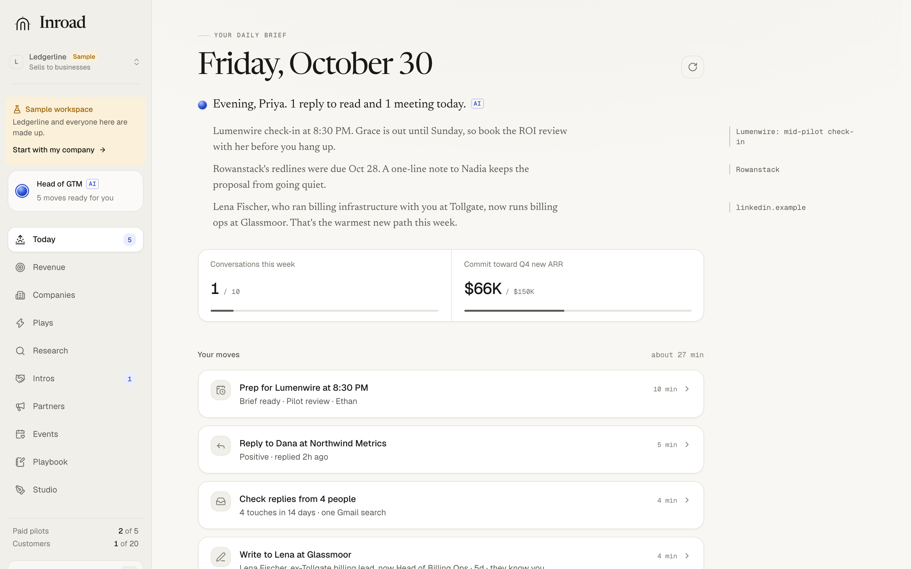
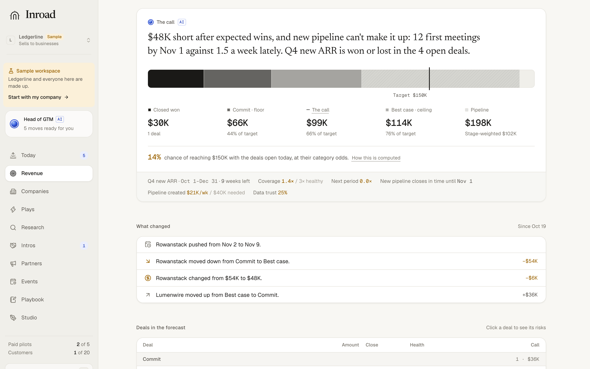
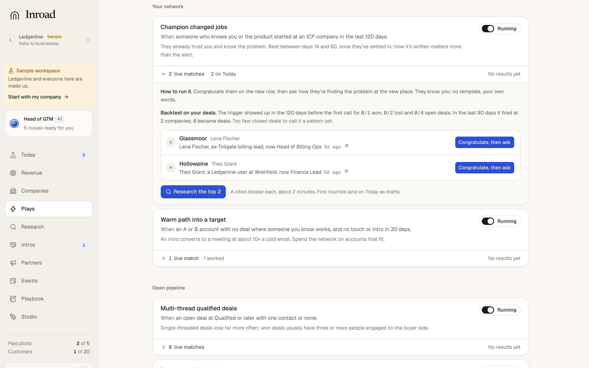
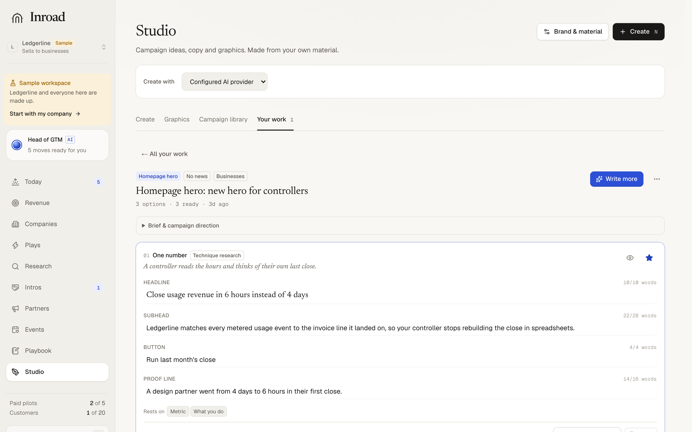
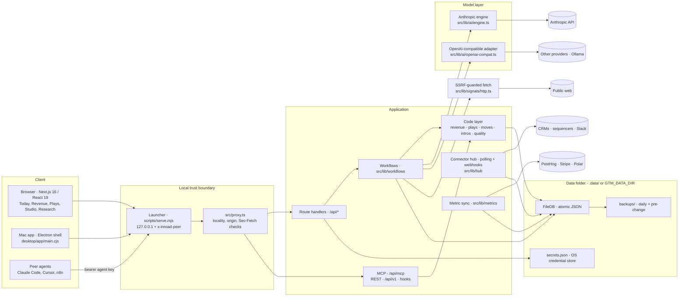

<div align="center">

# Inroad

**An AI Head of GTM for founder-led sales — finds who to talk to and why now, drafts every touch with verifiable sources, preps every call, and runs the revenue number from your own deals.**

[What it does](#what-it-does) · [Tour](#product-tour) · [Capabilities](#core-capabilities) · [Architecture](#architecture) · [Engineering](#engineering-deep-dives) · [Quick start](#getting-started) · [Mac app](docs/MAC-APP.md) · [Docs](#documentation)

<br/>

[](https://github.com/aiden-guan/inroad/actions/workflows/ci.yml)
[](LICENSE)
[](package.json)
[](package.json)

<br/>


</div>

---

## What It Does

**Your first 20 customers, not 20,000 cold emails.**

Inroad does the operating work a strong Head of GTM does at an early-stage company. It finds high-intent accounts and dated buying signals (warm paths in your network first), drafts each touch with its sources attached, prepares a dossier before every call, debriefs meetings, plans local dinners, and keeps a weekly rhythm. For the person who owns the number, it calls the quarter deal by deal from evidence, shows deal risk with the fix, and runs signal-based plays with backtests. The forecast and the plays are computed in code, not by a model.

**You do the selling.** Inroad never sends an email, posts a message or changes a deal stage on its own. Every outbound artifact is a draft you approve.

**It fits the company you run.** Selling to businesses gets Revenue, Companies, Plays, Intros, Partners and Events. Consumer apps, DTC brands and marketplaces get Growth (retention before acquisition) and Creators. Research, Playbook and Studio serve both, and you can switch modes at any time without losing data.

**It runs where you choose.** It runs locally in a browser or as a [Mac app](docs/MAC-APP.md), on the AI provider you pick: Anthropic Claude (what it was built and tuned on), OpenAI, Gemini, xAI, Groq, OpenRouter, Mistral, DeepSeek, Together AI, Vercel or Cloudflare AI Gateway, a local Ollama model, or any OpenAI-compatible API. Your data stays in one folder on your machine.

---

## Product Tour

All four screens show the built-in sample workspace: Ledgerline and every person, deal and number in it are made up. The pages were captured from v0.2.22 in mock mode.

| Today: the daily brief and five moves | Revenue: the quarter, called from evidence |
| :---: | :---: |
| [](assets/readme/today.png) | [](assets/readme/revenue.png) |
| **Plays: trigger, backtest, live matches** | **Studio: options checked against format limits** |
| [](assets/readme/plays.png) | [](assets/readme/studio.png) |

---

## Core Capabilities

### Sell

| Today's Moves | Sourced Deal Dossiers |
| :--- | :--- |
| **Five moves a day, ranked**<br/>Reply checks, deal reviews, touch approvals and closeouts are scored from 78 rule types in [`src/lib/moves/rules.ts`](src/lib/moves/rules.ts). The top five (`TOP_MOVES = 5`) arrive with ready-to-send copy. | **Every claim has a source**<br/>Angles, pains and qualification hypotheses link to source URLs and dates. Inferences are labeled as unconfirmed bets. |

| Warm Intro State Machine | Deterministic Signal Radar |
| :--- | :--- |
| **Connector etiquette in code**<br/>Intros move through `asked → forwarded → introduced → meeting → done`. Each connector gets one open ask, a 14-day rest and a give-first prompt after 3 asks. No model is involved. | **Code-first research**<br/>Job boards (Greenhouse, Lever, Ashby, Workable), site changes, news, Hacker News, EDGAR and public records are read over plain HTTP before any model is called. |

### Run the number

| Revenue Operating System | Signal-Based Plays |
| :--- | :--- |
| **The quarter, called like a forecast meeting**<br/>Each open deal is called commit, best case or pipeline from evidence: economic buyer, paper process, a buyer-agreed step within 14 days, and no recent slip. You get floor, call and ceiling, the chance of hitting target, coverage, and a reverse waterfall back to the meetings needed. Small samples are shrunk toward stated priors. | **13 always-on programs with an audit trail**<br/>Plays cover new leader, hiring for the pain, funding, champion moved, closed-lost by reason, referrals, lookalikes and more. Each shows live matches with the dated trigger, what it skipped and why, a backtest against your won and lost deals, and its results. |

| Deal Inspection | Metrics & Weekly Priorities |
| :--- | :--- |
| **Every risk with its fix**<br/>Slips, overdue or unconfirmed next steps, thin threading, no economic buyer, stalls and silence are flagged against research-backed thresholds, each with a one-click fix. A weekly update for the CEO or board uses a numbers table built in code. | **Read-only PostHog, Stripe and Polar syncs**<br/>Metrics refresh every 15 minutes while the app is open. An initiative captures its baseline and tracks progress automatically. Pipeline creation and stage progression show their denominators. See [business metrics](docs/business-metrics.md) and [GTM execution](docs/gtm-execution.md). |

### Market & research

| Studio | Research Hub |
| :--- | :--- |
| **Copy that has to pass lint before a reader ranks it**<br/>Studio covers 20 formats with documented platform limits, from launch posts and ads to Show HN and store listings. Every specific must trace to your material. Drafts are linted in code for AI tells, unsourced numbers and "up to" drift, then a blind reader ranks them. It includes a library of 20 campaign studies and SVG graphics rendered locally. See [Studio + Claude plan](docs/STUDIO-CLAUDE.md) and [ChatGPT plan](docs/STUDIO-CHATGPT.md). | **Search, evidence, monitors, outcomes**<br/>Research offers source and date filters, the actual queries and pages shown, saved page monitors, and connected MCP or OpenAPI GET tools. Imports run through dedupe and suppression rules. Retained provenance links accepted accounts to replies, meetings and wins. See the [Research guide](docs/RESEARCH.md). |

| Consumer Growth | Multi-Agent Coordination Hub |
| :--- | :--- |
| **Retention before acquisition**<br/>Week-4 retention is checked against your category's bar, plus activation, the Sean Ellis 40% survey, quick ratio, CAC and payback, all computed in code. Creator briefs require disclosure, and the linter covers FTC endorsement and 16 CFR 465 rules. A [waitlist counter](docs/waitlists.md) reads Convex, Supabase or Postgres. See the [consumer research](docs/research/10-consumer-gtm.md). | **An MCP server and REST API with agent keys**<br/>Claude Code, Cursor, ChatGPT, Meta Muse or n8n can call 21 tools, including `ask_inroad`, `get_playbook`, `find_warm_paths`, `get_forecast`, `list_plays`, `check_copy` and `add_accounts`. HubSpot, Attio, Instantly, Smartlead, lemlist and Cal.com/Calendly sync by webhook, or by polling when no webhook can reach the app. |

---

## Architecture

Inroad is a single-user Next.js 16 app that runs on the founder's machine. A launcher binds it to loopback. Plain-code layers gather facts and make every decision, and a model is called only to write. State lives in atomic JSON files in one data folder.



### End-to-End Execution Flow

1. **Request enters through the launcher.** `scripts/serve.mjs` listens on 127.0.0.1 and stamps each request with its real socket address. `src/proxy.ts` rejects anything that is not local, same-origin or an authenticated agent route.
2. **Code gathers the facts.** A workflow in `src/lib/workflows/` reads company sites, job boards, news and public records through `src/lib/signals/http.ts`, then dedupes, scores and compresses them into a digest.
3. **A model writes.** The digest goes to `src/lib/ai/engine.ts`, or to `openai-compat.ts` for other providers. On Anthropic, the task tier picks Opus 5.5 (positioning), Sonnet 5.5 (research and drafting) or Haiku 5.5 (classification and short rewrites) per `src/lib/ai/models.ts`. Stable system blocks carry cache breakpoints.
4. **Output must pass schema and quality gates.** Terminal tools (`submit_*`) are zod-validated. A submit that breaks its caps gets at most two resubmits. Drafts then pass `src/lib/quality/gates.ts` and the Studio linter.
5. **State is committed atomically and streamed.** Results are written to the data folder by write-and-rename in `src/lib/store/file-db.ts` and streamed over SSE. Each run ends with a receipt like `Worked for 1m 52s · 9 sources · $0.04`.

---

## Engineering Deep Dives

### 1. Localhost Is the Attack Surface

- **Problem**: A local web app is reachable from every website the founder visits. A page can fire cross-site POSTs at `localhost` to add an exfiltration webhook. DNS rebinding can point an attacker's hostname at `127.0.0.1`. A timing probe on `/api/favicon` can reveal which companies are on the list. Once a tunnel is on for webhooks, the port is public, and `X-Forwarded-*` headers are client-controlled.
- **Approach**: The launcher (`scripts/serve.mjs`) listens on 127.0.0.1 only and overwrites `x-inroad-peer` with the socket's real address. `src/proxy.ts` then requires a loopback peer and a local `Host` header. It rejects cross-site and same-site reads by `Sec-Fetch-Site`, and rejects any state-changing request whose `Origin` is not Inroad's own. Only the routes that authenticate every call themselves (`/api/mcp`, `/api/v1`, `/api/hooks/[source]/[secret]`) pass through a tunnel. Started without the launcher, the app refuses every page and explains how to start it correctly.
- **Why**: Next.js does not hand the proxy the socket, and any header can be forged by another device on the network. Locality decided by a stamped socket address cannot be spoofed by a caller.
- **Tradeoff**: A bare `next dev` or `next start` is unusable by design, and Inroad cannot run on serverless or shared hosts. Anything already running on the same computer can still reach the app, so the computer itself is the trust boundary ([details](docs/OPERATIONS.md#only-this-computer)).

### 2. SSRF Guard Checked at Connect Time

- **Problem**: Inroad fetches URLs that come from founders, imports, webhooks and external agents. A hostname that passes validation can resolve to `127.0.0.1`, `169.254.169.254` or an IPv4-mapped IPv6 address by the time the socket opens (DNS rebinding).
- **Approach**: `src/lib/signals/http.ts` builds a `net.BlockList` of private, loopback, link-local and CGNAT ranges, including IPv6 forms that embed IPv4 (NAT64, 6to4). It installs a `guardedLookup` on a custom `undici` Agent. Redirects are followed manually (`redirect: "manual"`), and every hop is checked again. API tokens and custom auth headers are dropped when a redirect changes origin, including an HTTPS → HTTP downgrade.
- **Why**: Checking a URL with a separate `dns.resolve()` leaves a time-of-check/time-of-use gap. Checking inside the connect-time lookup validates the address the socket actually uses.
- **Tradeoff**: Research can never read an intranet or loopback page, even on purpose. Local AI endpoints such as Ollama use the provider client instead.

### 3. Prompt Caching That Tests Hold in Place

- **Problem**: Multi-turn tool loops re-send the same system prompt, ICP and dossier on every turn. Strict tool schemas reject `maxLength`, `minimum` and similar constraints, and every resubmitted tool call re-bills the whole conversation.
- **Approach**: `src/lib/ai/engine.ts` orders system blocks from most to least stable. It puts breakpoints on the last block, and on the second-to-last when there are three or more, then lets the top-level marker follow the conversation so turn N reads turn N−1, within the 4-breakpoint limit. `strictSafe()` moves unsupported size constraints into field descriptions, and zod enforces them after the call, with at most two resubmits. Recorded workflow "tapes" in `src/test/fixtures/anthropic/` replay in the unit suite. A request whose cache TTL, `max_tokens`, effort or tool set differs from the tape fails the test.
- **Why**: Cache reads bill at 0.05× input on Opus 5.5 and 0.1× on Sonnet and Haiku 5.5 (`src/lib/ai/models.ts`). A silent cache break is therefore expensive and invisible, so it is caught in CI rather than on the invoice.
- **Tradeoff**: Editing a stable block or a tool definition invalidates the cache, and changing a workflow's prompts means re-recording its tapes (`npm run tapes:record`).

---

## How It Keeps Token Spend Low

1. **Code gathers, the model writes.** Sites, career portals, news, DNS and public records are fetched over HTTP, cached and compressed before any model call. See [`docs/research/08-token-cost-architecture.md`](docs/research/08-token-cost-architecture.md).
2. **Each task gets the cheapest capable model.** Opus 5.5 handles positioning and hard judgment, Sonnet 5.5 research synthesis and drafting, Haiku 5.5 classification and extraction. TypeScript does ranking, scoring, dedupe, intros, forecasts, plays and linting at 0 tokens.
3. **Instant answers skip the model.** Ask answers forecast, at-risk, priority and overdue questions directly from workspace data.
4. **Search is capped.** Direct reads come first, and external web search has a daily request limit (100 by default, set under Settings → Web search).
5. **Peer agents pay for their own inference.** When an agent calls Inroad over MCP, its host pays for the model. Tools like `check_copy` lint at zero cost to Inroad.
6. **Maps and people data stay off the model.** A built-in gazetteer of 216 places in `src/lib/geo/places.ts` places leads offline. People lookup uses Apollo or FullEnrich credits instead of search loops.
7. **Every run shows its cost.** Receipts and a monthly budget appear under Settings → Usage. Off Anthropic, spend is counted only for models with a known price, and an unknown price is never shown as $0.

---

## Technology Stack

| Layer | Choices |
| :--- | :--- |
| **Client** | Next.js 16 App Router, React 19, Radix UI (Dialog, Dropdown, Popover, Tooltip), cmdk, Tailwind CSS 4, Motion, `@number-flow/react`, MapLibre GL with OpenFreeMap tiles |
| **AI** | `@anthropic-ai/sdk` with adaptive thinking; an OpenAI-compatible Chat Completions adapter for every other provider; per-task and per-message model routing ([AI routing](docs/AI-ROUTING.md)) |
| **Validation** | Zod 4 for tool schemas, API bodies and runtime types |
| **Agent interface** | MCP over Streamable HTTP (`/api/mcp`) and a REST API (`/api/v1`), both authenticated with hashed agent keys |
| **Signals & security** | `undici` with a connect-time `guardedLookup` and `net.BlockList`; `node-html-parser`; a loopback-only launcher with a request proxy |
| **Persistence** | Atomic local JSON (`src/lib/store/file-db.ts`); AI keys in the OS credential store via `@napi-rs/keyring` or an AES-256-GCM file; connector keys in `secrets.json`; none reach the browser |
| **Desktop** | Electron and electron-builder (`desktop/`), with a SHA-256-verified self-updater |
| **Testing** | Vitest (unit and recorded-tape replays), Playwright (browser end to end), calibration evals for the critic and reply classifier |

---

## Getting Started

### Prerequisites

- Node.js 20.9 or newer (CI uses 24; `.nvmrc` pins it for `nvm use`)
- npm (v10 or later)
- A key for your AI provider. You don't need one for the built-in mock, and Ollama needs none.

### Quick Start

```bash
git clone https://github.com/aiden-guan/inroad.git
cd inroad
npm install
npm run dev
```

Open [http://localhost:3000](http://localhost:3000) and paste a provider key on the first screen. The provider follows the key's format (`sk-ant-…` Anthropic, `sk-proj-…` OpenAI, `AIza…` Gemini, `gsk_…` Groq, `sk-or-…` OpenRouter, and so on). To look around first, choose **Explore a sample workspace**. It is labeled as made up everywhere, and **Start with my company** leaves it in one click.

Prefer a key in the environment? Copy [`.env.example`](.env.example) to `.env.local` and set `ANTHROPIC_API_KEY`. A key saved in the app takes precedence.

### Zero-Key Mock Mode

A mock of the Anthropic, OpenAI-compatible and Firecrawl APIs ships with the repository. It runs each workflow's tools the way a model would, bills realistic token and cache usage, and can fail on demand.

```bash
npm run mock:anthropic   # terminal 1: mock APIs on :4010
npm run dev:mock         # terminal 2: Inroad on :3100 with its own data folder (.data-mock)
```

Fault injection, the request log and Windows usage are covered in [Testing and the offline mock](docs/TESTING.md).

### Mac App

Download **Inroad-mac-arm64** or **Inroad-mac-x64** from the latest green **Actions → Mac app** run, or from a tagged **Release**. Builds are ad hoc signed until a Developer ID is configured, so macOS asks you to allow them once under **Privacy & Security**. Installed apps update themselves from GitHub Releases after a SHA-256 and signature check. Building, signing and releasing are covered in [The Mac app](docs/MAC-APP.md).

### Everyday Use

For a production server, data folder location, backups, one-click updates and a stable public URL for webhooks, see [Running Inroad day to day](docs/OPERATIONS.md).

---

## Configuration

Everything can be set in the app. Environment variables are for servers and scripts; the full table is in [OPERATIONS.md](docs/OPERATIONS.md#environment-variables).

| Variable | Purpose |
| :--- | :--- |
| `GTM_DATA_DIR` | Data folder (default `.data/` in the repository; point it somewhere your computer backs up) |
| `ANTHROPIC_API_KEY` | Anthropic key, if not pasted in the app. Other providers follow the same pattern. |
| `PORT` | Server port (default 3000) |
| `INROAD_SIGNING_SECRET` | Signing secret for outgoing webhooks (Zapier, Slack, n8n) |
| `INROAD_UPDATE_CHECK` | `off` stops automatic update checks |

**Keep your data outside the repository.** By default, data lives in `.data/` inside this folder, so deleting or re-cloning the repository (or `git clean -xfd`) deletes it too. Give it a folder of its own:

```bash
GTM_DATA_DIR="$HOME/Library/Application Support/Inroad" npm start   # macOS
GTM_DATA_DIR="$HOME/.local/share/inroad" npm start                  # Linux
```

On Windows PowerShell: `$env:GTM_DATA_DIR = "$env:APPDATA\Inroad"; npm start`. Settings → Data shows which folder is in use.

---

## Verification & Testing

```bash
npm test             # Vitest: unit tests and recorded workflow replays, offline
npm run typecheck    # tsc --noEmit (run `npx next typegen` once on a fresh checkout)
npm run lint         # ESLint
npm run e2e          # Playwright, against the mock with outbound DNS disabled
```

- **Unit suite**: 1,481 tests across 143 files passing, 3 skipped, measured at v0.2.22. Each test gets an ephemeral data directory. The clock is pinned to `America/Los_Angeles`, and non-localhost network calls are rejected.
- **Workflow replays**: The main workflows replay recorded API exchanges and fail if a run falls back to compatibility mode, is cut off at `max_tokens`, misses its submit tool, or produces a receipt that disagrees with the usage.
- **Evals**: `npm run eval:critic` and `npm run eval:classify` gate the draft critic and reply classifier against calibration sets. CI runs them against the mock, and against the real model when an `ANTHROPIC_API_KEY` secret is set.
- **Live smoke** (not in CI): `npm run smoke:live` runs the workflow tests against the real API behind a cost-capped proxy.
- **CI**: `.github/workflows/ci.yml` runs typegen, typecheck, lint, tests, evals, `next build` and a separate Playwright job on every push. `.github/workflows/desktop.yml` builds the Mac app.

Details for each command are in [Testing and the offline mock](docs/TESTING.md).

---

## Repository Structure

```text
inroad/
├── desktop/                  # Mac app: Electron shell, updater, credentials, electron-builder config
├── docs/                     # Guides (operations, testing, AI routing, metrics) and the product SPEC
│   └── research/             # Sourced research behind each feature: GTM playbook, token costs, plays, copy
├── e2e/                      # Playwright browser tests, offline against the mock
├── scripts/                  # Launcher (serve.mjs), mock AI APIs, live smoke, tape recorder, evals, release
├── src/
│   ├── proxy.ts              # Local trust boundary: locality, origin and Sec-Fetch checks
│   ├── app/
│   │   ├── (app)/            # Pages: today, revenue, plays, companies, intros, partners, events,
│   │   │                     #   growth, studio, research, playbook, integrations, settings
│   │   ├── api/              # Route handlers, MCP (/api/mcp), REST (/api/v1), inbound hooks
│   │   └── welcome/          # First-run onboarding
│   ├── components/           # React UI, one folder per surface
│   ├── lib/
│   │   ├── ai/               # Anthropic engine, OpenAI-compatible adapter, routing, model pricing
│   │   ├── workflows/        # Discovery, dossier, compose, prep, debrief, Ask, GTM update, Studio
│   │   ├── revenue/          # Forecast call, deal risk, reverse waterfall, attribution
│   │   ├── plays/            # 13 plays: triggers, matches, backtests, results
│   │   ├── moves/            # Today's move rules and scoreboard
│   │   ├── intros/           # Warm intro state machine and etiquette rules
│   │   ├── consumer/         # Consumer mode: growth math, benchmarks, creator compliance
│   │   ├── studio/           # Copy formats, moves, receipts, lint, SVG graphics
│   │   ├── signals/          # SSRF-guarded HTTP client, job board, news and records parsers
│   │   ├── search/           # Research search providers, ranking, budgets
│   │   ├── metrics/          # PostHog, Stripe and Polar syncs
│   │   ├── hub/              # Connector webhooks, polling, CRM sync
│   │   ├── api-keys/         # MCP tools and REST auth
│   │   ├── quality/          # Draft gates and linters
│   │   ├── server/           # Launcher, local-request and desktop helpers
│   │   └── store/            # Atomic FileDB and AI key storage
│   └── test/                 # Fixtures, recorded tapes and test setup
├── .env.example              # Environment variable template
└── vitest.config.mts         # Hermetic Vitest configuration
```

---

## Documentation

| Guide | Covers |
| :--- | :--- |
| [Running Inroad day to day](docs/OPERATIONS.md) | Production server, updates, data folder, backups, public URL, key storage, all environment variables |
| [The Mac app](docs/MAC-APP.md) | Download, first open, updates, building, signing and releasing |
| [Testing and the offline mock](docs/TESTING.md) | Mock faults, tapes, Playwright, live smoke, evals, CI |
| [AI connections and routing](docs/AI-ROUTING.md) | Multiple accounts, per-task models, AI gateways |
| [Research guide](docs/RESEARCH.md) | Search providers, monitors, MCP and OpenAPI connections |
| [Business metrics](docs/business-metrics.md) · [GTM execution](docs/gtm-execution.md) · [Waitlists](docs/waitlists.md) | Metric definitions, initiatives, pipeline diagnostics |
| [Product spec](docs/SPEC.md) · [Security policy](SECURITY.md) | Scope, non-goals, reporting a vulnerability |
| [Changelog](CHANGELOG.md) | Every release with its validation |

---

## Project Status & Limitations

- **Maturity**: Functional MVP with tagged releases (v0.2.22 as of 2026-10-30), a Mac app, and CI covering unit, browser and eval checks. No usage, revenue or conversion results are claimed. Reported campaign outcomes in Studio's library are the publishers' own, not evidence that a given line converts.
- **Single user, single machine**: Inroad cannot be deployed to Vercel, serverless or a shared host, and two people cannot share a workspace. A hosted version would need a login and a real database ([why](docs/OPERATIONS.md#what-it-cant-do)).
- **Model support**: The prompts were written and tested on Claude. Other tool-calling models run the same workflows through Chat Completions, and small local models may need occasional retries. Off Anthropic, web search uses a separately chosen provider.
- **No sending**: There is deliberately no SMTP or IMAP sender. All outreach waits for your approval.
- **Unsigned builds**: Mac builds are ad hoc signed until a Developer ID is added, so macOS asks once per version.
- **Studio graphics**: The OpenAI Images route is tested against a local mock only. The ChatGPT-plan route was verified with one real PNG. Fonts depend on the machine rendering the SVG.

---

## License

This project is licensed under the terms of the [MIT License](LICENSE).
